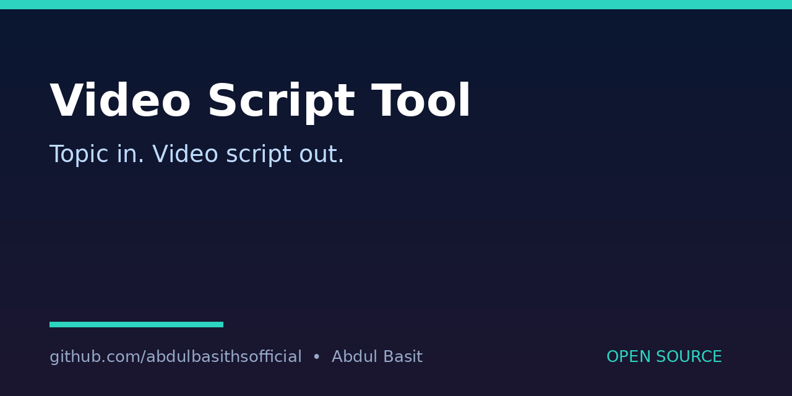

# VideoScript-Tool
Benefit: Turns a topic or a rough script into a ready video plan — narration script, captions, scene list and background-music cues — so creators can plan a video without starting from a blank page.

## What it does
Takes a topic and optional notes and outputs a structured text plan: a short narration script, caption lines, a scene-by-scene list, and music cues. Output is text only.

## What it does not do
It does not render, edit or publish video. Any claim about video rendering would be false for this tool, so none is made.

## Quick start
```bash
python3 script_tool.py --topic "How AI agents help small shops" --notes "keep it simple, 2 minutes"
```

## How to run
- Run the command above with your own topic. Output is printed to the terminal; redirect it to a file with `> plan.md` if you want to save it.
